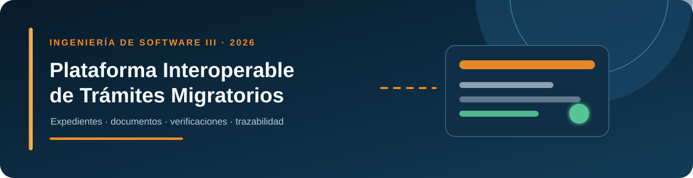

# 📚 Documentación · Trámites Migratorios

  

  
  
  

  <a href="#-qué-encontrarás">🎯 Qué encontrarás</a> ·
  <a href="#-documentos-base">🧱 Documentos base</a> ·
  <a href="#-entregables-por-sprint">🚀 Sprints</a> ·
  <a href="#-criterio-del-proyecto">🔐 Criterio</a>

<strong>Arquitectura · desarrollo · QA · DevOps · trazabilidad</strong> El registro técnico que acompaña la evolución del MVP

---

## 🎯 Qué encontrarás

Este directorio reúne la documentación del **Sistema Interoperable para la Gestión de Trámites Migratorios en Panamá**, desarrollado como un MVP académico para organizar expedientes, documentos, verificaciones y trazabilidad en un bufete de abogados.

Aquí se puede seguir la historia completa del proyecto: desde el análisis del problema y la arquitectura inicial hasta las pruebas de seguridad, rendimiento, usabilidad y las presentaciones de los Sprints.

El **portal P-01…P-27** corresponde al cliente del bufete y el **módulo interno I-01…I-18** corresponde al despacho: recepción, análisis, resolución, notificación, administración y auditoría.

La documentación se organiza en documentos base, entregables por Sprint y documentación individual. Los documentos están conectados entre sí: la arquitectura define la estructura técnica; el plan de acción organiza el trabajo; el plan de desarrollo explica cómo se construirá el sistema; el plan de pruebas establece cómo se validará; y el backlog convierte el proyecto en épicas, historias de usuario y tareas ejecutables.

La propuesta parte del problema identificado: el proceso oficial puede tardar entre 3 y 8 meses, según el caso planteado —**referencia externa del proceso oficial, no una meta del producto**— debido a la entrega repetida de documentos y a las verificaciones manuales. El producto reduce tareas redundantes preparando y organizando los expedientes del despacho.

Las **instituciones se abordan como fuentes externas de verificación** (fuentes públicas, p. ej. cédula del Tribunal Electoral y Registro Público; documentos obtenidos con consentimiento o autorización del titular), **no como socias con APIs**. El modo actual es la **verificación manual asistida**: la plataforma guarda solo el resultado mínimo de verificación (fuente, fecha, resultado y responsable), y la **capa de adaptadores queda preparada para futuros convenios** de verificación automática (p. ej. vía la AIG) sin rehacer el sistema; la posible participación de la AIG se limita a esa coordinación tecnológica futura.

Alcance importante: cualquier convenio o integración automática dependerá de permisos, convenios, interfaces disponibles y validaciones jurídicas correspondientes. Por ello, el producto (MVP) debe poder funcionar con datos ficticios y fuentes de verificación simuladas, sin asumir acceso directo a bases de datos gubernamentales.

## 🧱 Documentos base

| # | Documento | Archivo |
| --- | --------- | ------- |
| 1 | Propuesta de arquitectura | [01-propuesta-de-arquitectura.md](documentos-base/01-propuesta-de-arquitectura.md) |
| 2 | Plan de acción | [02-plan-de-accion.md](documentos-base/02-plan-de-accion.md) |
| 3 | Plan de desarrollo | [03-plan-de-desarrollo.md](documentos-base/03-plan-de-desarrollo.md) |
| 4 | Plan de pruebas | [04-plan-de-pruebas.md](documentos-base/04-plan-de-pruebas.md) |
| 5 | Backlog detallado del proyecto: siete sprints | [05-backlog-siete-sprints.md](documentos-base/05-backlog-siete-sprints.md) |
| 6 | Roles y accesos | [06-roles-y-accesos.md](documentos-base/06-roles-y-accesos.md) |
| 7 | Marco legal y matriz de fuentes de verificación (HU-06) | [07-marco-legal-y-matriz-fuentes-verificacion.md](documentos-base/07-marco-legal-y-matriz-fuentes-verificacion.md) |

## 🚀 Entregables por Sprint

| Sprint | Contenido |
| --- | --- |
| [Sprint 0](sprint-0/README.md) | Documento, presentación y enlace del video. |
| [Sprint 1](sprint-1/README.md) | Documento y presentación del avance de desarrollo. |
| [Sprint 2](sprint-2/README.md) | Documento y presentación del video del software. |
| [Sprint 3](sprint-3/README.md) | Review #1, documento y presentación. |
| [Sprint 4](sprint-4/README.md) | Historias, triple restricción, QA, factura y presentación. |
| [Sprint 5](sprint-5/README.md) | Refinamiento del MVP, presupuesto y presentación. |
| [Sprint 6](sprint-6/README.md) | Review #2, documento del cierre y presentación técnica. |

## 🧩 Documentos por rama de trabajo

Derivados del backlog maestro (`documentos-base/05-backlog-siete-sprints.md`), cada documento explica a una rama **qué tiene que hacer** (historias y tareas por sprint) y **con qué hacerlo** (herramientas obligatorias y complementarias):

| Rama | Archivo | Herramientas obligatorias principales |
| --- | --- | --- |
| Frontend | [README del Frontend](../Frontend/README.md) | Docker, Java (lectura de API), JMeter y ZAP en correcciones |
| Backend | [README del Backend](../Backend/README.md) | Java, Docker, JMeter y ZAP en correcciones |
| QA y Seguridad | [Rama-03-QA-Seguridad.md](documentos-base/Rama-03-QA-Seguridad.md) | OWASP ZAP, Apache JMeter, Docker, Java |
| Producto y Documentación | [Rama-04-Producto-Documentacion.md](documentos-base/Rama-04-Producto-Documentacion.md) | Docker, revisión de informes ZAP/JMeter |
| DevOps | [README de DevOps](../DevOps/README.md) | Docker (central), Git/CI, Java (compilación), entornos de ZAP y JMeter |

> **Inventario oficial de pantallas adoptado: 45** (portal P-01…P-27 + módulo interno I-01…I-18), según `Pantallas_y_Datos_Migracion.md`; el cambio está registrado en el registro de cambios del backlog (`documentos-base/05-backlog-siete-sprints.md`) y el documento `documentos-base/06-roles-y-accesos.md`.

## 🔐 Criterio del proyecto

- El MVP trabaja con datos ficticios y servicios simulados.
- No se declaran conexiones reales con Tribunal Electoral, CSS o Registro Público.
- La verificación actual es manual asistida y conserva únicamente el resultado mínimo necesario.
- Las futuras integraciones dependerán de convenios, permisos, interfaces disponibles y validación jurídica.
- La documentación de QA conserva las evidencias reproducibles de pruebas funcionales, seguridad, rendimiento y usabilidad.
- Las presentaciones y documentos de cada Sprint se conservan junto con su README para facilitar la revisión académica.

## 📖 Diferencia entre los documentos

| Documento | Qué define |
| --------- | ---------- |
| Propuesta de arquitectura | Cómo se estructura el sistema y cómo se comunican sus componentes. |
| Plan de acción | Qué se hará, en qué orden, quién lo hará, qué recursos necesita y cómo se medirá el resultado. |
| Plan de desarrollo | Cómo se implementarán los módulos, las bases de datos, las API y las reglas de negocio. |
| Plan de pruebas | Cómo se comprobarán la funcionalidad, la seguridad, el rendimiento y la usabilidad. |
| Backlog | Qué épicas, historias de usuario y tareas concretas se ejecutarán en cada uno de los siete sprints. |
| Roles y accesos | Quién accede al sistema, a qué pantallas, API y datos, bajo qué reglas de autenticación y auditoría. |
