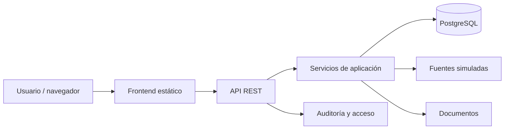
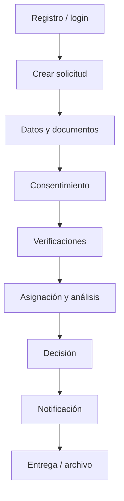

# TASK-32.3 · OpenAPI, diagramas y modelo de datos

## Alcance

Esta tarea consolida el contrato REST (`Backend/docs/openapi.yaml`), la arquitectura Docker, el flujo del expediente y el modelo lógico de datos.

## Contrato OpenAPI

La especificación vigente está en `Backend/docs/openapi.yaml`, versión 0.5.0. Describe autenticación, perfil, expedientes, documentos, estados, observaciones, verificaciones, consentimientos y solicitudes ARCO. Todo cambio futuro debe actualizar el changelog de API.

## Arquitectura



Docker Compose coordina frontend, backend y PostgreSQL. El backend aplica autenticación, autorización, validaciones, reglas del expediente y migraciones Flyway.

## Flujo del expediente



Un error técnico de verificación no equivale a un resultado negativo; se conserva la trazabilidad y se permite reintento según la regla del servicio.

## Modelo lógico

```mermaid
erDiagram
 USUARIO ||--o{ EXPEDIENTE : crea
 EXPEDIENTE ||--o{ DOCUMENTO : contiene
 EXPEDIENTE ||--o{ VERIFICACION : solicita
 EXPEDIENTE ||--o{ CONSENTIMIENTO : requiere
 EXPEDIENTE ||--o{ HISTORIAL_ESTADO : registra
 USUARIO ||--o{ AUDITORIA : genera
 USUARIO { uuid id PK; string rol; string tipo_solicitante; string nombres; string apellidos; date fecha_nacimiento }
 EXPEDIENTE { uuid id PK; uuid titular_id FK; string motivo; string estado; datetime creado_en }
 DOCUMENTO { uuid id PK; uuid expediente_id FK; string tipo; string nombre; string mime; string estado }
 VERIFICACION { uuid id PK; uuid expediente_id FK; string fuente; string estado }
 CONSENTIMIENTO { uuid id PK; uuid expediente_id FK; string tipo; datetime otorgado_en }
 HISTORIAL_ESTADO { uuid id PK; uuid expediente_id FK; string estado_anterior; string estado_nuevo }
 AUDITORIA { uuid id PK; uuid usuario_id FK; string accion; datetime creado_en }
```

## Reglas técnicas

1. La identidad autenticada se valida en backend antes de guardar un expediente.
2. El Pasante de Bufete usa datos ficticios solo en el flujo de demostración autorizado.
3. Los documentos se validan por tipo y tamaño; la descarga debe comprobar autenticación y autorización.
4. Las verificaciones se asignan por área y no conceden facultad para aprobar trámites.
5. Flyway es la fuente de evolución del esquema.

## Referencias

- `Documentacion/sprint-7-task-32.1-manual-tecnico.md`
- `Documentacion/sprint-7-task-32.2-manual-usuario.md`
- `docs/evidencias/`

Estado: **documentada localmente, pendiente de revisión del Product Owner**. No se hizo commit ni push.
