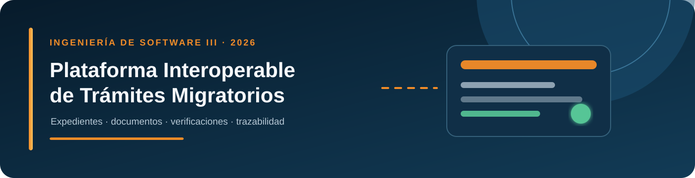

<p align="center">
  
</p>

<p align="center">
  
</p>

<p align="center">
  
  
  
</p>

> Rama dedicada a comprobar que el sistema sea funcional, seguro, usable y confiable antes de integrarlo a `main`.

<p align="center">
  <a href="QA/README.md">📋 Evidencias QA</a> ·
  <a href="QA/sprint-6/">Sprint 6</a> ·
  <a href="Documentacion/">Documentación</a>
</p>


## 🎯 Propósito de esta rama

QA concentra las pruebas y evidencias del proyecto. Aquí se validan los flujos del portal, las pantallas internas, las respuestas del backend, el rendimiento, la seguridad y la experiencia de uso.

La rama no reemplaza el desarrollo de `Frontend` o `Backend`; verifica que los cambios funcionen juntos y deja evidencia reproducible para el equipo.

## ✅ Qué se revisa

- Flujos de inicio de sesión y control de acceso.
- Creación, consulta y seguimiento de expedientes.
- Documentos, observaciones, subsanaciones y resultados.
- Verificaciones con servicios simulados.
- Validaciones de formularios y reglas de negocio.
- Contraste visual, responsive y accesibilidad básica.
- Rendimiento con JMeter y seguridad con OWASP ZAP, cuando aplica.

## 🧪 Evidencias

Las evidencias se organizan por sprint dentro de `QA/`. Cada resultado debe indicar qué se probó, con qué herramienta, cuál fue el resultado y qué decisión técnica se tomó.

> El sistema utiliza datos ficticios y servicios simulados. No se prueban datos reales de instituciones gubernamentales.

## ▶ Ejecución local

Desde la raíz del repositorio:

```bash
docker compose up --build
```

Después se puede abrir el frontend en `http://localhost:8081/html/index.html` según la configuración local del entorno.

<p align="center">
  
</p>
