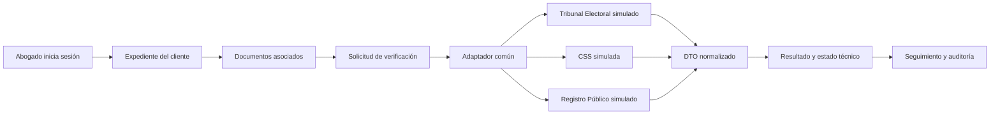

# Plataforma Interoperable de Trámites Migratorios

<p align="center">
  
  
  
</p>

> Una plataforma académica para que un bufete pueda organizar expedientes migratorios, consultar documentos y dar seguimiento a verificaciones desde un solo lugar.

Este repositorio contiene el proyecto integrador de **Ingeniería de Software III**. La solución se construye como un MVP: primero demostramos el flujo principal de forma segura y trazable, y después dejamos preparadas las bases para futuras integraciones.

## El problema que estamos resolviendo

Los trámites migratorios pueden tardar meses cuando la información está repartida, los documentos se revisan manualmente y no existe una vista clara del estado del expediente. Esto genera duplicidad, errores de seguimiento y poca visibilidad para el bufete y sus clientes.

Nuestra propuesta centraliza el expediente del cliente y organiza el flujo del abogado:

1. Inicia sesión.
2. Abre o crea el expediente del cliente.
3. Asocia los documentos necesarios.
4. Solicita verificaciones a fuentes simuladas.
5. Consulta el resultado normalizado y el estado técnico.
6. Da seguimiento al trámite con trazabilidad.

> **Importante:** el sistema utiliza datos ficticios y servicios simulados. No consulta APIs reales del Tribunal Electoral, la CSS ni el Registro Público.

## Qué incluye el MVP

| Módulo | Qué permite demostrar |
| --- | --- |
| Acceso por roles | Cada usuario ve las funciones que le corresponden. |
| Expedientes | El abogado registra y consulta la información del cliente. |
| Documentos | Los documentos se asocian al expediente correcto. |
| Verificaciones | Se consultan tres fuentes simuladas mediante adaptadores. |
| DTO común | Las respuestas incluyen fuente, resultado, referencia, fecha, responsable y estado técnico. |
| Reintentos | Se manejan errores, timeouts e idempotencia sin crear duplicados. |
| Trazabilidad | Se registra quién realizó la operación, cuándo y qué resultado obtuvo. |

## Flujo técnico



## Arquitectura del proyecto

```text
Tr-mites-Migratorios/
├── Backend/              API, reglas de negocio, DTOs y pruebas
├── Frontend/             Pantallas, estilos y flujo del usuario
├── QA/                   Evidencias de pruebas, seguridad y calidad
├── DevOps/               Entorno, CI/CD, despliegue y reproducibilidad
├── Documentacion/        Backlog, arquitectura, roles y entregas por Sprint
├── docs/                 Convenciones, entornos y evidencias generales
├── docker/               Nginx y configuración del proxy
├── docker-compose.yml    Servicios locales del proyecto
└── Versiones_Anteriores/ Material histórico de ramas archivadas
```

## Tecnologías

| Área | Herramientas |
| --- | --- |
| Backend | Java 17, Spring Boot y Maven |
| Base de datos | PostgreSQL 16 y Flyway |
| Frontend | HTML, CSS y JavaScript modular |
| Entorno | Docker y Docker Compose |
| Servidor web | Nginx |
| Pruebas | JUnit, Spring Test, Testcontainers y Apache JMeter |
| Seguridad | OWASP ZAP, roles y datos ficticios |
| Trabajo en equipo | GitHub y TeamTrack |

## Ejecutar el proyecto

### Requisitos

- Git.
- Docker Desktop instalado y ejecutándose.
- Al menos 4 GB de memoria disponibles para Docker.
- JDK 17 o superior si se ejecutará el backend fuera de Docker.

### Opción recomendada: Docker Compose

```bash
git clone https://github.com/Death272004/Tr-mites-Migratorios.git
cd Tr-mites-Migratorios
docker compose up --build
```

| Servicio | Dirección |
| --- | --- |
| Frontend | <http://localhost:8081> |
| Backend | <http://localhost:8080> |
| Salud del backend | <http://localhost:8080/actuator/health> |
| Salud del frontend | <http://localhost:8081/salud> |
| PostgreSQL | `localhost:5433` |

Para detener los contenedores:

```bash
docker compose down
```

Para detenerlos y eliminar la base de datos local:

```bash
docker compose down -v
```

### Si un puerto ya está ocupado

```bash
cp .env.example .env
```

Edita `.env` y cambia `DB_PORT`, `BACKEND_PORT` o `FRONTEND_PORT`. Ese archivo es local: no debe subirse al repositorio.

### Ejecutar únicamente el backend

```bash
docker compose up -d db
cd Backend
./mvnw spring-boot:run -Dspring-boot.run.profiles=local
```

En Windows se utiliza `mvnw.cmd` en lugar de `./mvnw`.

## Ejecutar pruebas

Pruebas del backend:

```bash
cd Backend
./mvnw test
```

Validación rápida de JavaScript:

```bash
find Frontend/js -name '*.js' -print0 | xargs -0 -n1 node --check
```

Pruebas de calidad y seguridad:

- **Apache JMeter:** usuarios simulados, tiempos de respuesta, peticiones y errores.
- **OWASP ZAP:** revisión básica de seguridad sobre el entorno local.
- **JUnit/Testcontainers:** pruebas automatizadas del backend y la persistencia.

## Cómo trabajamos con Git

Las ramas de rol mantienen separado el trabajo de cada área:

| Rama | Responsable principal |
| --- | --- |
| `main` | Versión estable del proyecto |
| `Backend` | Servicios, reglas y persistencia |
| `Frontend` | Pantallas y experiencia de usuario |
| `QA` | Pruebas, seguridad y evidencias |
| `DevOps` | Entorno, integración y CI/CD |
| `Documentacion` | Backlog, informes y entregables |

Para iniciar una tarea nueva:

```bash
git switch main
git pull origin main
git switch -c feature/nombre-de-la-tarea
```

Después de trabajar y probar:

```bash
git add .
git commit -m "tipo: describir el cambio"
git push -u origin feature/nombre-de-la-tarea
```

La rama se integra mediante Pull Request después de verificar que el proyecto compile, las pruebas pasen y la documentación esté actualizada. `main` se reserva para una versión estable y demostrable.

## Equipo y responsabilidades

| Integrante | Responsabilidad principal |
| --- | --- |
| Kenneth Carter | Scrum Master, DevOps e integración del entorno |
| Edgar Rosario | Backend y servicios |
| Jonathan Gómez | Frontend e interfaces |
| Vivian Paris | QA y seguridad |
| Richard Rodríguez | Documentación y coordinación técnica |

## Documentación útil

- [Documentación general](Documentacion/README.md)
- [Backend y API](Backend/README.md)
- [DevOps y despliegue](DevOps/README.md)
- [Frontend](Frontend/README.md)
- [QA y seguridad](QA/README.md)
- [Evidencias técnicas](docs/evidencias/README.md)
- [Evidencia QA del Sprint 5](QA/sprint-5/README.md)
- [Documentación base](Documentacion/documentos-base/)
- [Convenciones de Git](docs/CONVENCIONES-GIT.md)
- [Entornos y secretos](docs/ENTORNOS-Y-SECRETOS.md)

## Reglas importantes

- Utilizar únicamente datos ficticios en desarrollo, pruebas y demostraciones.
- No subir contraseñas, tokens, archivos `.env` ni datos personales.
- Representar las instituciones externas mediante mocks y adaptadores simulados.
- Registrar las decisiones técnicas importantes en la documentación.
- Probar los cambios antes de solicitar su integración.
- Cualquier integración real requiere autorización institucional y revisión de seguridad.

## Estado actual

El proyecto se encuentra en la etapa de refinamiento del MVP. El foco actual es cerrar el recorrido completo del abogado, demostrar las verificaciones simuladas y presentar evidencias de calidad, seguridad, trazabilidad y DevOps para el Sprint 6.

---

**Proyecto universitario · Ingeniería de Software III · Panamá · 2026**
