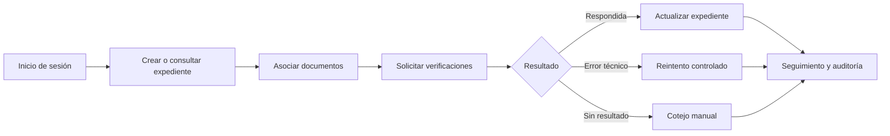

# Plataforma Interoperable de Trámites Migratorios

**Sistema académico para la gestión y verificación de trámites migratorios en Panamá.**

> Una plataforma para que un bufete pueda organizar expedientes, documentos y verificaciones de forma segura, trazable y ordenada.


## ¿Qué problema resolvemos?

Los trámites migratorios pueden tardar meses por la revisión manual de documentos, la falta de seguimiento y la información dispersa entre distintas instituciones. Esta plataforma centraliza el expediente del cliente y permite al bufete controlar el avance del trámite desde un solo lugar.

El proyecto utiliza datos ficticios y fuentes simuladas para representar verificaciones con el Tribunal Electoral, la CSS y el Registro Público. No realiza conexiones institucionales reales.

## Funcionalidades principales

- Inicio de sesión y control de acceso por roles.
- Registro y seguimiento de expedientes migratorios.
- Carga y consulta de documentos.
- Verificaciones manuales y simuladas.
- Manejo de errores técnicos, reintentos e idempotencia.
- Minimización de datos y validación de consentimiento.
- Historial, auditoría y trazabilidad de operaciones.
- Panel de seguimiento para el cliente y el personal del bufete.

## Flujo principal



## Tecnologías

| Capa | Tecnología |
| --- | --- |
| Backend | Java 17, Spring Boot, Maven |
| Persistencia | PostgreSQL 16, Flyway |
| Frontend | HTML, CSS y JavaScript modular |
| Servidor web | Nginx |
| Entorno | Docker Compose |
| Calidad | JUnit, Spring Test, Testcontainers |
| Control de versiones | Git y GitHub |

## Cómo ejecutar el proyecto

### Requisitos

- Docker Desktop instalado y ejecutándose.
- Git.
- Al menos 4 GB de memoria disponible para Docker.
- Para ejecutar el backend fuera de Docker: JDK 17 o superior.

### Opción recomendada: Docker Compose

Clona el repositorio y entra en la carpeta del proyecto:

```bash
git clone https://github.com/Death272004/Tr-mites-Migratorios.git
cd Tr-mites-Migratorios
```

Levanta el backend, PostgreSQL y frontend:

```bash
docker compose up --build
```

Cuando los contenedores estén saludables, abre:

- Frontend: <http://localhost:8081>
- Backend: <http://localhost:8080>
- Salud del backend: <http://localhost:8080/actuator/health>
- Salud del frontend: <http://localhost:8081/salud>
- PostgreSQL: `localhost:5433`

Para detener los servicios:

```bash
docker compose down
```

Para detenerlos y eliminar los datos locales de PostgreSQL:

```bash
docker compose down -v
```

### Cambiar puertos locales

Si los puertos ya están ocupados, copia la plantilla de configuración:

```bash
cp .env.example .env
```

Después cambia en `.env` `DB_PORT`, `BACKEND_PORT` o `FRONTEND_PORT`. El archivo `.env` es local y no debe subirse al repositorio.

### Ejecutar solo el backend fuera de Docker

Mantén PostgreSQL levantado y ejecuta:

```bash
docker compose up -d db
cd Backend
./mvnw spring-boot:run -Dspring-boot.run.profiles=local
```

En Windows utiliza `mvnw.cmd` en lugar de `./mvnw`.

## Usuarios ficticios de demostración

El entorno local crea usuarios de prueba para demostrar los roles del sistema. Las credenciales se encuentran documentadas en [`Backend/README.md`](Backend/README.md). Son datos de demostración y no deben utilizarse en producción.

## Ejecutar las pruebas

Desde la raíz del proyecto:

```bash
cd Backend
./mvnw test
```

Las pruebas levantan una base PostgreSQL de prueba mediante Testcontainers. También se pueden validar los archivos JavaScript con:

```bash
find Frontend/js -name '*.js' -print0 | xargs -0 -n1 node --check
```

## Estructura del proyecto

| Carpeta | Contenido |
| --- | --- |
| `Backend/` | API Spring Boot, reglas de negocio, migraciones y pruebas |
| `Frontend/` | Portal del cliente, módulo interno, HTML, CSS y JavaScript |
| `Documentacion/` | Arquitectura, backlog, roles, marco legal y entregas por Sprint |
| `QA/` | Evidencias y validaciones de calidad |
| `DevOps/` | Entorno reproducible, CI/CD y evidencias de integración |
| `docs/` | Convenciones técnicas, ambientes y evidencias históricas |
| `docker/` | Configuración de Nginx y proxy hacia el backend |
| `Versiones_Anteriores/` | Material histórico de ramas y versiones anteriores |

## Equipo

| Integrante | Área principal |
| --- | --- |
| Kenneth Carter | DevOps, integración y entorno |
| Edgar Rosario | Backend y servicios |
| Jonhatan (Jonas) | Frontend e interfaces |
| Vivian Paris | QA y validación |
| Richard Rodriguez | Documentación y coordinación técnica |

## Documentación relacionada

- [Documentación general](Documentacion/README.md)
- [Backend y API](Backend/README.md)
- [Evidencias técnicas](docs/evidencias/README.md)
- [Evidencia QA del Sprint 5](QA/sprint-5/README.md)
- [Documentación de integración futura autorizada](Documentacion/documentos-base/09-integracion-automatica-autorizada.md)

## Reglas del proyecto

- Utilizar únicamente datos ficticios en desarrollo, pruebas y demostraciones.
- No subir contraseñas, tokens, archivos `.env` ni datos personales.
- Las instituciones externas se representan mediante mocks y adaptadores simulados.
- Toda integración futura con una institución requiere convenio, autorización y revisión de seguridad.

---

Proyecto universitario de Ingeniería de Software III · Panamá · 2026
